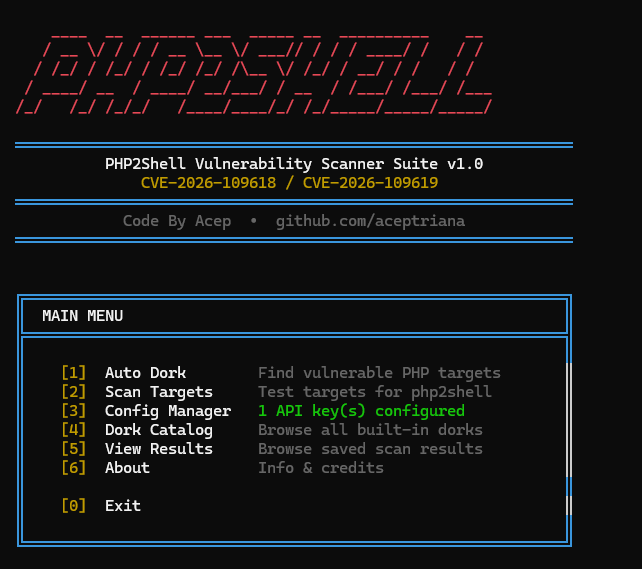

<div align="center">



# PHP2Shell Scanner Suite

**Automated discovery and exploitation-readiness scanner for PHP2Shell vulnerabilities**

[](https://nvd.nist.gov/)
[](https://nvd.nist.gov/)
[](https://python.org)
[](LICENSE)

**Code By [Acep](https://github.com/aceptriana) • [github.com/aceptriana](https://github.com/aceptriana)**

</div>

---

## Overview

PHP2Shell Scanner Suite is a complete toolkit for discovering and scanning PHP applications vulnerable to **CVE-2026-109618** and **CVE-2026-109619** — a critical memory-exhaustion class of vulnerability affecting unpatched PHP installations that allows remote code execution via crafted multipart requests.

The suite combines automated OSINT target discovery (dorking) with a precise vulnerability prober, all wrapped in a clean interactive terminal menu.

---

## Vulnerable PHP Versions

| Branch | Vulnerable Range | Fixed in |
|--------|-----------------|----------|
| PHP 8.2 | 8.2.0 – 8.2.34 | **8.2.35** |
| PHP 8.3 | 8.3.0 – 8.3.35 | **8.3.36** |
| PHP 8.4 | 8.4.0 – 8.4.26 | **8.4.27** |
| PHP 8.5 | 8.5.0 – 8.5.11 | **8.5.12** |

> **How it works:** The scanner sends crafted multipart probes (1 MiB → 20 MiB) with PHP array keys nested 62 levels deep. A vulnerable target responds with a PHP memory-exhaustion fatal error, an empty HTTP 500 differential, or a PHP-FPM worker crash. Patched versions handle the payload safely.

---

## Features

- **Interactive menu launcher** — color-coded terminal UI with live subprocess streaming
- **8 OSINT backends** — Google, DuckDuckGo, Yahoo (free scrape) + Bing, Shodan, Censys, FOFA, ZoomEye (API)
- **82+ built-in dorks** — organized by backend, targeting phpinfo pages, phpMyAdmin, version headers, and fatal error pages
- **Persistent API key store** — `~/.php2shell/config.json` with masked display and live connection tests
- **Multi-path scanning** — custom paths, phpMyAdmin auto-rerouting, mod_php and PHP-FPM verdict modes
- **JSON results** — structured output with verdict, SAPI, reason, and redacted HTTP evidence

---

## Suite Overview

```
php2shell-scanner/
├── main.py        ← Interactive menu launcher  (start here)
├── scanner.py     ← Vulnerability prober
├── dork.py        ← OSINT target discovery
├── config.py      ← API key & settings manager
├── dork.txt       ← Full dork catalog (82+ queries)
└── requirements.txt
```

---

## Installation

```bash
git clone https://github.com/aceptriana/php2shell
cd php2shell-scanner
pip install -r requirements.txt
```

**Requirements:**

```
h11>=0.14.0
tqdm>=4.64.0
requests>=2.28.0
colorama>=0.4.6
pyfiglet>=0.8.0
```

Python 3.9 or newer is required.

---

## Quick Start

### Interactive menu (recommended)

```bash
python main.py
```

The menu guides you through the full workflow:

```
[1]  Auto Dork        →  find vulnerable PHP targets via OSINT
[2]  Scan Targets     →  probe found targets for php2shell
[3]  Config Manager   →  set and test API keys
[4]  Dork Catalog     →  browse all 82 built-in dork queries
[5]  View Results     →  review saved scan output
[0]  Exit
```

### CLI workflow (headless / scripted)

```bash
# 1. Store an API key (optional — Google/DDG/Yahoo work without keys)
python config.py --set shodan_api_key=YOUR_KEY

# 2. Collect targets via dorking
python dork.py --google --ddg -o targets.txt

# 3. Scan collected targets
python scanner.py -l targets.txt -t 20 -o results.json
```

---

## Tools Reference

### `main.py` — Interactive Launcher

```bash
python main.py
```

The full-featured TUI. No arguments needed — use the numbered menu.

---

### `scanner.py` — Vulnerability Prober

```bash
# Single target
python scanner.py -u https://example.com

# List of targets
python scanner.py -l targets.txt -t 20 -o results.json

# Custom paths
python scanner.py -u https://example.com --path /index.php --path /admin.php

# PHP-FPM only mode
python scanner.py -l targets.txt --sapi fpm -v

# With custom headers
python scanner.py -u https://example.com -H "Cookie: session=abc"
```

| Option | Description |
|--------|-------------|
| `-u` | Single URL to scan |
| `-l` | File of hosts (one per line) |
| `-t` | Concurrent threads (default: 10) |
| `--timeout` | Request timeout in seconds (default: 60) |
| `-o` | Save results to JSON file |
| `--sapi` | Verdict mode: `auto`, `fpm`, `mod_php` |
| `--path` | Custom path(s) to test |
| `--path-file` | File of paths to test |
| `-H` | Custom request header (repeatable) |
| `-k` | Disable TLS verification |
| `-v` | Verbose output with reasons |
| `-q` | Quiet — only print vulnerable hosts |

**Verdicts:**

| Verdict | Meaning |
|---------|---------|
| `VULNERABLE` | Crash signal observed — target is unpatched |
| `FIXED` | No crash and X-Powered-By confirms patched version |
| `INCONCLUSIVE` | Probe was rejected or errored before PHP parsed it |
| `NO SIGNAL` | No crash and no version information available |

---

### `dork.py` — Auto Dorking

```bash
# Free backends (no key needed)
python dork.py --google --ddg --yahoo -o targets.txt

# With Shodan
python dork.py --shodan -o targets.txt

# All configured backends
python dork.py --all -o targets.txt -n 200

# Use custom dork file
python dork.py --shodan --dork-file dork.txt -o targets.txt

# JSON output
python dork.py --google --json -o targets.json

# Show all built-in dorks
python dork.py --list-dorks
```

**Backends:**

| Flag | Engine | Key Required | Plan |
|------|--------|-------------|------|
| `--google` | Google web scrape | ❌ Free | — |
| `--ddg` | DuckDuckGo HTML | ❌ Free | — |
| `--yahoo` | Yahoo web scrape | ❌ Free | — |
| `--bing` | Bing Web Search API | ✅ `bing_api_key` | Azure free tier |
| `--shodan` | Shodan Search API | ✅ `shodan_api_key` | Freelancer $49+ |
| `--censys` | Censys Hosts v2 | ✅ `censys_api_id` | Free tier available |
| `--fofa` | FOFA Search | ✅ `fofa_email` + `fofa_key` | Free tier available |
| `--zoomeye` | ZoomEye Host Search | ✅ `zoomeye_api_key` | JWT token |

---

### `config.py` — API Key Manager

Keys are stored at `~/.php2shell/config.json`. A local override file `./config.local.json` can be used for project-level keys (add it to `.gitignore`).

**Priority chain:** CLI flag → Environment variable → config file

```bash
# Set keys
python config.py --set shodan_api_key=sk-xxxxx
python config.py --set censys_api_id=ID censys_api_secret=SECRET
python config.py --set fofa_email=you@mail.com fofa_key=xxxxx
python config.py --set zoomeye_api_key=JWT-xxxxx

# Show current config (keys masked)
python config.py --show

# Reveal actual values
python config.py --show --reveal

# Test a key live
python config.py --test shodan
python config.py --test all

# Tune settings
python config.py --set default_max_per_dork=200
python config.py --set google_delay=5.0

# Remove a key
python config.py --delete bing_api_key

# Wipe everything
python config.py --reset
```

**Supported keys:**

| Key | Description |
|-----|-------------|
| `shodan_api_key` | Shodan Search API key |
| `bing_api_key` | Bing Web Search subscription key |
| `censys_api_id` | Censys API ID |
| `censys_api_secret` | Censys API secret |
| `fofa_email` | FOFA account email |
| `fofa_key` | FOFA API key |
| `zoomeye_api_key` | ZoomEye JWT token |

**Settings:**

| Setting | Default | Description |
|---------|---------|-------------|
| `default_max_per_dork` | 100 | Max results per dork query |
| `request_timeout` | 20 | HTTP timeout (seconds) |
| `google_delay` | 4.0 | Delay between Google pages (seconds) |
| `ddg_delay` | 3.0 | Delay between DDG pages |
| `yahoo_delay` | 3.0 | Delay between Yahoo pages |
| `shodan_delay` | 1.0 | Delay between Shodan pages |

---

### `dork.txt` — Dork Catalog

The dork catalog file contains 82+ pre-built queries across all 8 backends. Each line follows `backend:query` format.

```bash
# Use the full catalog
python dork.py --all --dork-file dork.txt -o targets.txt

# Use only specific backends from the file
python dork.py --shodan --fofa --dork-file dork.txt -o targets.txt
```

Adding custom dorks — append to `dork.txt`:

```
# My custom dorks
google:site:example.com intitle:"phpinfo()"
shodan:"X-Powered-By: PHP/8.3" country:"ID"
fofa:header="X-Powered-By: PHP/8.3" && country="ID"
```

---

## Complete Workflow Example

```bash
# Step 1 — configure your best available API key
python config.py --set shodan_api_key=YOUR_KEY
python config.py --test shodan

# Step 2 — collect targets (use --all if you have keys for all backends)
python dork.py --google --ddg --shodan -n 200 -o targets.txt

# Step 3 — scan everything with 20 threads
python scanner.py -l targets.txt -t 20 -o results.json --sapi auto -v

# Step 4 — review vulnerable hosts
python -c "
import json
data = json.load(open('results.json'))
vuln = [r for r in data if r.get('vulnerable')]
print(f'{len(vuln)} vulnerable hosts:')
for r in vuln:
    print(f'  {r[\"host\"]}  —  {r[\"powered_by\"]}  [{r[\"sapi\"]}]')
"
```

---

## Environment Variables

All API keys can be provided as environment variables instead of (or in addition to) the config file:

```bash
export SHODAN_API_KEY=xxxxx
export BING_API_KEY=xxxxx
export CENSYS_API_ID=xxxxx
export CENSYS_API_SECRET=xxxxx
export FOFA_EMAIL=you@mail.com
export FOFA_KEY=xxxxx
export ZOOMEYE_API_KEY=xxxxx
```

---

## Output Format

Scanner results are saved as a JSON array. Each entry contains:

```json
{
  "host":        "https://192.168.1.1",
  "vulnerable":  true,
  "verdict":     "VULNERABLE",
  "sapi":        "PHP-FPM",
  "reason":      "probe 1 (1 MiB, 4000 parts) crashed the request handler: ...",
  "powered_by":  "PHP/8.3.10",
  "status_code": 500,
  "tested_url":  "https://192.168.1.1/index.php",
  "timestamp":   "2026-10-23T12:00:00Z",
  "request":     "POST /index.php HTTP/1.1 ...",
  "response":    "HTTP/1.1 500 ..."
}
```

---

## Limitations & False Positives

On specific PHP configurations the scanner may report a false positive when its multipart probe exceeds PHP's `memory_limit` on a **patched** build. This was reproduced on:

- Patched PHP 8.4.27 with `memory_limit` from **2M to 32M**
- PHP 8.3.36 at **128M** when `max_multipart_body_parts` is set to **2785 or higher**

When PHP does not disclose its version in response headers, the scanner cannot distinguish this safe post-patch OOM from vulnerable pre-patch behavior. Always verify results against the installed PHP version and any vendor backports.

---

## Legal Notice

This tool is intended for **authorized security testing, bug bounty research, and educational purposes only**. Scanning systems without explicit written permission is illegal in most jurisdictions. The author assumes no liability for misuse.

---

## Credits

| Role | Credit |
|------|--------|
| **Tool Author** | [Acep](https://github.com/aceptriana) |
| **php2shell Discovery** | [Calif Security Team](https://calif.io/php2shell/) |
| **Scanner Logic Reference** | [Assetnote Security Research](https://www.slcyber.io/exposure) |

---

<div align="center">

**Code By Acep • [github.com/aceptriana](https://github.com/aceptriana)**

*PHP2Shell Scanner Suite — CVE-2026-109618 / CVE-2026-109619*

</div>
